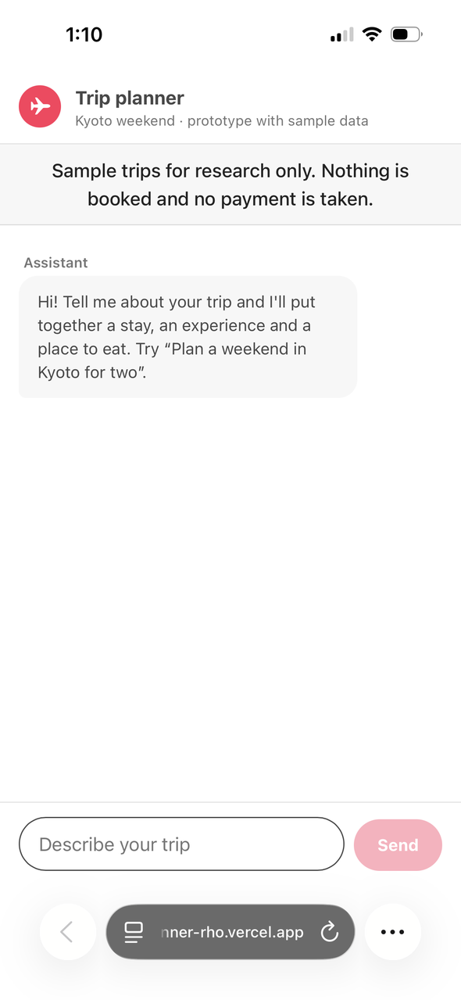
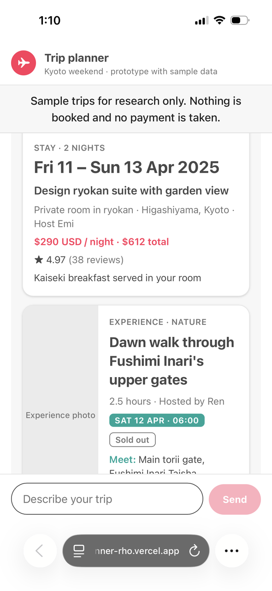
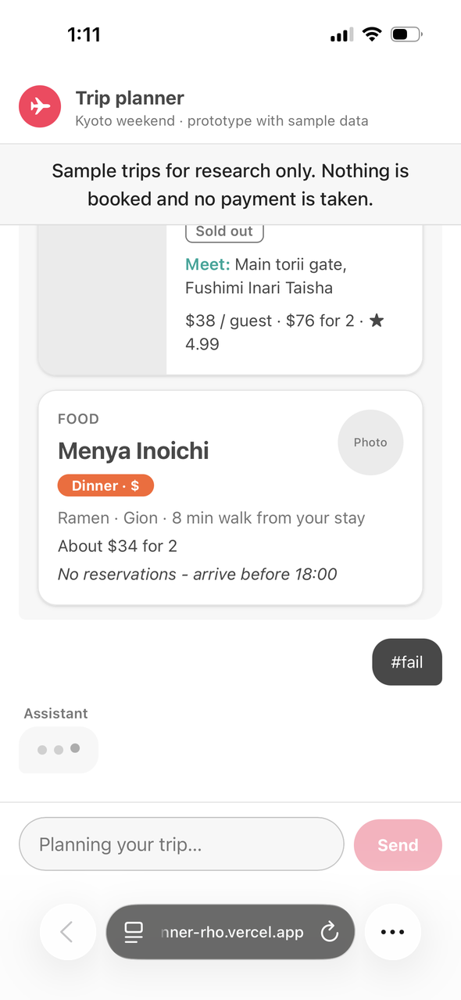
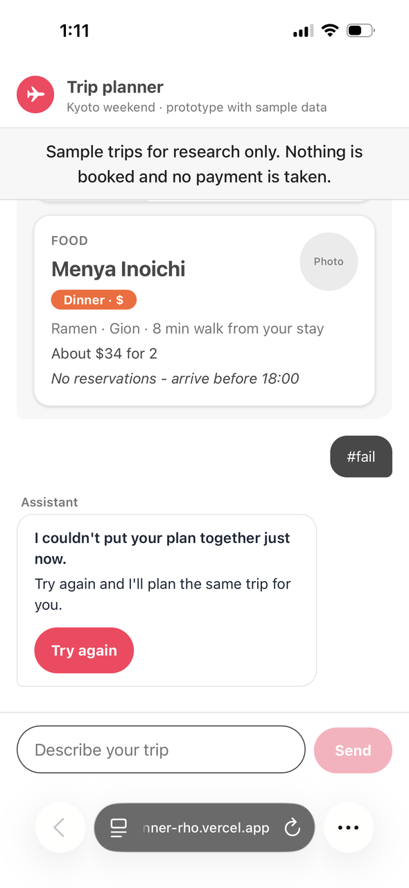
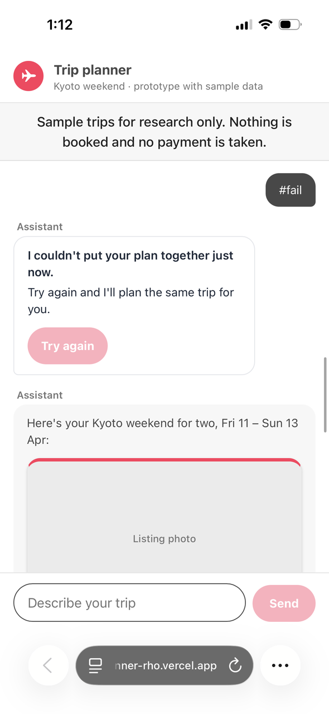
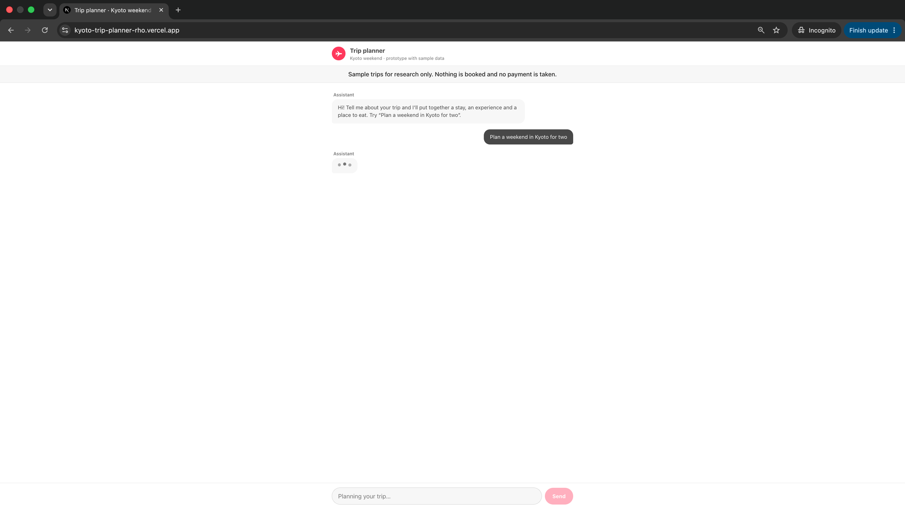
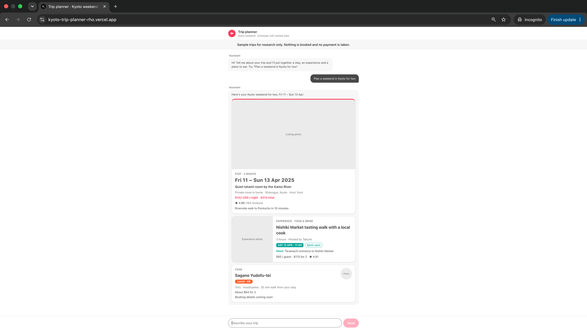
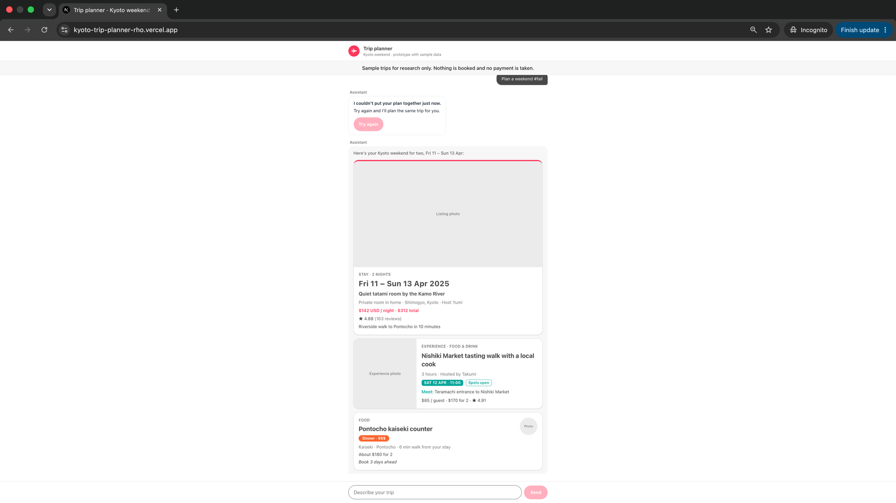

# Trip planner chat · Kyoto weekend prototype

**Live prototype: https://kyoto-trip-planner-rho.vercel.app/**

This is the production Vercel domain. It opens in a private or incognito window with no login, no install and no configuration.

A chat prototype for Airbnb UX Research: send a trip request and the assistant replies with three cards, a stay, an experience and a place to eat. All trips are sample data. Nothing is booked and no payment is taken.

## Try it

1. **Happy path:** type `Plan a weekend in Kyoto for two` and press Send.
2. **Error path:** type `Plan a weekend in Kyoto for two #fail` and press Send, then press **Try again**. `#fail` makes the first request after a page load fail, so no code needs editing. Reload the page to trigger it again.

## Checklist: Moderated Session Prototype Requirements

Tested on the live link on 17 Nov 2026, in a private window on both setups:

- 📱 **Phone:** iPhone, Safari private window
- 💻 **Laptop:** MacBook, Chrome incognito window

| | Requirement | Phone | Laptop |
|---|---|---|---|
| ✅ | Opens from the production `*.vercel.app` link in a private window, with no login, install or configuration | [P1](#phone) | [L1](#laptop) |
| ✅ | Visible wording that trips are sample data and nothing is booked | [P1](#phone) | [L1](#laptop)–[L3](#laptop) |
| ✅ | One typed trip request shows a thinking state first | [P3](#phone) | [L1](#laptop) |
| ✅ | Then three of three cards: stay, experience and food | [P2](#phone) + [P3](#phone) | [L2](#laptop) |
| ✅ | The three cards look clearly different, not one layout with the text swapped (see [The three cards](#the-three-cards)) | [P2](#phone) + [P3](#phone) | [L2](#laptop) |
| ✅ | At phone width, nothing is cut off and nothing needs sideways scrolling | [P1](#phone)–[P5](#phone) | n/a |
| ✅ | Forced failure shows a friendly message and a "Try again" button inside the assistant bubble | [P4](#phone) | [L3](#laptop) |
| ✅ | The chat is never empty: at the failure, when Try again is pressed, and after it | [P3](#phone)–[P5](#phone) | [L3](#laptop) |
| ✅ | Pressing Try again brings the three cards back | [P5](#phone) | [L3](#laptop) |
| ✅ | How to trigger the failure without editing code is written down | [Try it](#try-it) | [Try it](#try-it) |

## Screenshots

### Phone

| P1 · Start, with notice | P2 · Cards (stay, experience) | P3 · Food card, then thinking dots | P4 · Error bubble | P5 · After Try again |
|---|---|---|---|---|
|  |  |  |  |  |

A phone screen is too short to show all three cards at once, so P2 and P3 together show the stay, experience and food cards from one reply.

### Laptop

**L1 · Thinking state** after "Plan a weekend in Kyoto for two"



**L2 · Three of three cards:** stay, experience and food



**L3 · Error bubble and the cards after Try again:** the friendly message with Try again greyed out after pressing it, then the three cards in a new reply



## The three cards

Each card is its own component, with its own layout:

| Card | Image box | Biggest text | Accent colour | Component |
|---|---|---|---|---|
| Stay | Wide banner across the top | Travel dates (fixed: Fri 11 – Sun 13 Apr 2025) | Rausch (coral-pink) top border and price | `src/components/cards/StayCard.tsx` |
| Experience | Tall strip down the left | Activity name | Babu (teal) date and time label | `src/components/cards/ExperienceCard.tsx` |
| Food | Small round thumbnail, top right | Restaurant name | Arches (orange) meal and price pill | `src/components/cards/FoodCard.tsx` |

Images are grey placeholders because photo rights for the prototype are not cleared.

## Run it locally

```bash
npm install
npm run dev
```

Then open http://localhost:3000.

## Where things live

- `src/components/TripPlannerChat.tsx`: header, research notice, scrolling thread, message box, Send and Try again.
- `src/components/ErrorBubbleContent.tsx`: the friendly error message, following the Design Systems assistant-bubble guidelines.
- `src/lib/mockReply.ts`: the fake assistant (1.4 s delay, one random row per sheet) and the `#fail` switch.
- `src/lib/parseReply.ts`: checks a reply holds exactly one stay, one experience and one food card. Anything else shows the friendly bubble.
- `src/lib/mockData.ts`: every row of the content pack. Empty cells use the `FILLER` text.
