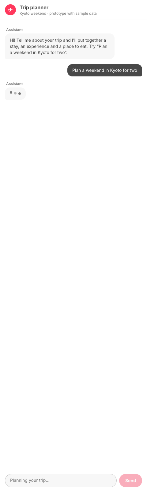
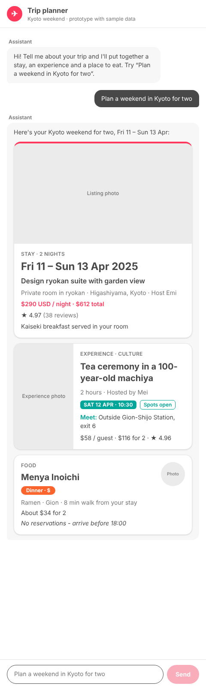
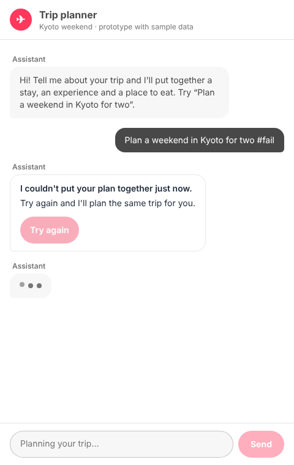
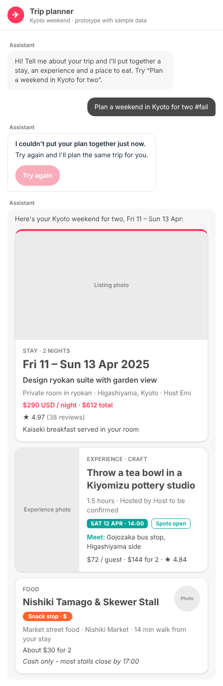

# Trip planner chat · Kyoto weekend prototype

A chat prototype for Airbnb: send a trip request and the assistant replies with three cards (stay, experience, food). Built with Next.js, TypeScript and Tailwind CSS.

## Run it

```bash
npm install
npm run dev
```

Open http://localhost:3000, type "Plan a weekend in Kyoto for two" and press Send (or Enter).

To see the friendly error bubble, add `#fail` to your message: the first such request after a page load fails, and Try again brings back the cards.

## Screenshots

| While thinking | After the reply | After Try again | Cards after Try again |
| --- | --- | --- | --- |
|  |  |  |  |

Images are grey placeholders because photo rights for the prototype are not cleared.

## Where things live

- `src/lib/mockData.ts`: every row of the content pack, typed in. Empty cells use the `FILLER` text.
- `src/lib/mockReply.ts`: the fake assistant (1.4 s delay, one random row per sheet).
- `src/components/TripPlannerChat.tsx`: header, scrolling thread, message box and Send button.
- `src/components/ThinkingDots.tsx`: the pulsing dots.
- `src/components/cards/`: `StayCard`, `ExperienceCard`, `FoodCard`.
